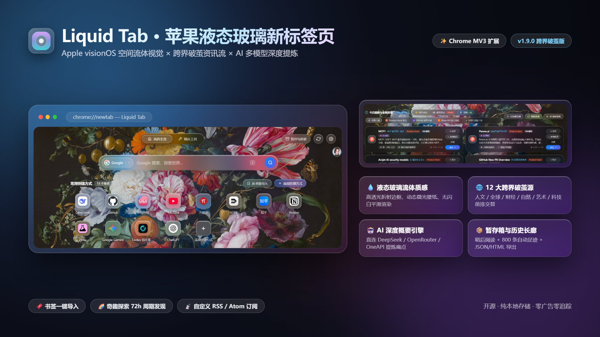
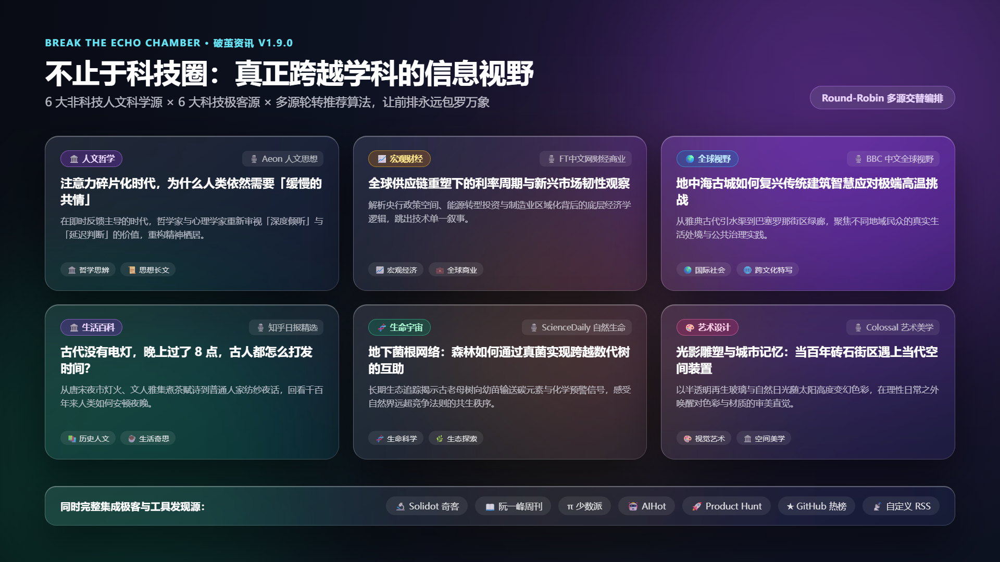
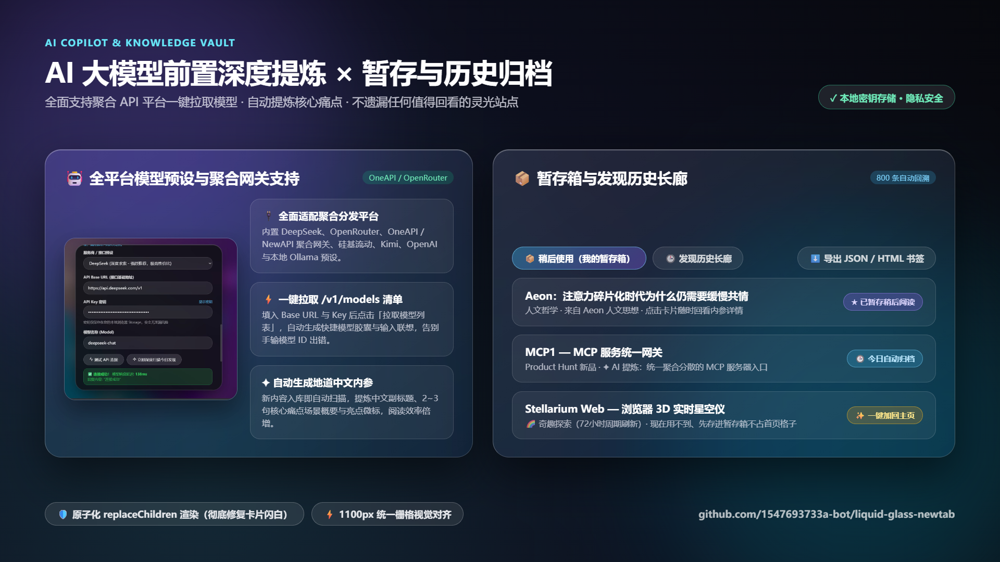

# Liquid Tab - 苹果液态玻璃极简起始页 (Chrome 新标签页扩展) v1.9.0

> 基于 Apple 现代「液态玻璃（Liquid Glass / visionOS 2 / iOS 18）」空间流体视觉语言打造的高级新标签页扩展。集成 **12 大跨界破茧资讯源（人文哲学 / 全球视野 / 宏观财经 / 自然科学 / 艺术美学 / 科技极客）**、**多源交替推荐引擎**、**AI 大模型多平台与聚合网关深度提炼**、**奇趣探索低频更新源** 以及 **暂存箱与 800 条历史归档系统**。

<p align="center">
  
</p>

---

## ✨ v1.9.0 跨界破茧资讯：不止于科技圈

信息茧房不仅存在于算法推荐里，也存在于「只看科技圈」的阅读习惯中。`v1.9.0` 对 **破茧资讯** 进行了全面跨界升级，采用 **Round-Robin 多源交替编排算法**，让主页前排内容真正跨越学科与圈层：

<p align="center">
  
</p>

### 🌐 6 大非科技跨界资讯源（新增）
- 🏛️ **Aeon 人文思想**（人文哲学）：哲学思辨、历史文化、社会人类学与当代思想长篇随笔（自动并发中文转译）。
- 📚 **知乎日报精选**（生活百科）：历史掌故、社会心理、博物科普与日常奇思妙问，自动抓取详情摘要。
- 🌍 **BBC 中文全球视野**（全球视野）：国际局势、社会变迁与跨文化深度观察。
- 📈 **FT中文网财经商业**（宏观财经）：全球宏观经济周期、金融市场脉动与商业策略分析。
- 🧬 **ScienceDaily 自然生命**（生命宇宙）：天文学、生命医学、脑科学与地球生态前沿实证发现。
- 🎨 **Colossal 艺术美学**（艺术设计）：当代视觉艺术、空间建筑、摄影美学与造物灵感。

### 🚀 6 大科技极客 & 4 大创新工具源
- **资讯与周刊**：`Solidot 奇客`、`阮一峰科技爱好者周刊`、`少数派 sspai`、`极客公园 GeekPark`、`Hacker News 精选`、`AIHot 前沿资讯 (aihot.news)`，另支持**自定义 RSS / Atom 订阅**。
- **创新工具**：`Product Hunt 新品`、`GitHub 热榜开源`、`Show HN 独立创造`、`V2EX 创想工坊`。

---

## 🤖 AI 深度提炼 × 暂存箱与发现历史长廊

<p align="center">
  
</p>

### 1. 全平台大模型预设 & 聚合 API 网关支持
- **全面适配**：内置 **DeepSeek（深度求索）**、**OneAPI / NewAPI 聚合分发平台**、**OpenRouter**、**硅基流动 (SiliconFlow)**、**阿里通义千问**、**Kimi**、**OpenAI** 及本地离线 **Ollama**，支持任意 OpenAI 兼容中转地址自动规范化。
- **一键拉取模型列表**：填写接口地址与密钥后，点击「拉取模型列表」即可自动获取 `/v1/models` 并生成模型快捷切换胶囊。
- **前置深度提炼**：自动扫描新发现的内容，提炼出地道中文副标题、2~3 句核心痛点场景概要与 3 个核心亮点微标。

### 2. 暂存箱与发现历史长廊（Archive & Vault）
- **📦 稍后使用（我的暂存箱）**：一键暂存「现在用不到、万一今后要用到」的宝藏网站与长文，不挤占首页常用快捷方式。
- **🕒 发现历史长廊**：自动沉淀每日全网发现与奇趣探索记录（上限 800 条），支持关键词检索与按平台回溯。
- **数据备份导出**：支持一键导出为 **JSON 备份** 或标准 **浏览器 HTML 书签**。

### 3. 奇趣探索与液态玻璃视觉打磨
- **🌈 奇趣探索（72 小时低频周期更新）**：结合 GitHub 生成艺术与互动创意站点池（Quick Draw、Weave Silk、Patatap、Earth 2050、Stellarium Web 等）。
- **💧 视觉规整与零闪白体验**：统一 `1100px` 栅格对齐、两段式导航胶囊、`replaceChildren()` 原子化 DOM 刷新与内联 SVG 兜底，彻底消除切换与刷新时的卡片闪白。

---

## 🚀 安装与使用指南

### 在 Chrome / Edge 浏览器中加载扩展
1. 克隆或下载本仓库到本地目录：
   ```bash
   git clone https://github.com/1547693733a-bot/liquid-glass-newtab.git
   ```
2. 在浏览器地址栏输入 `chrome://extensions/`（Edge 为 `edge://extensions/`）；
3. 打开右上角 **「开发者模式 (Developer mode)」**；
4. 点击 **「加载已解压的扩展程序 (Load unpacked)」**，选择本项目文件夹（包含 `manifest.json` 的目录）；
5. 按下 `Ctrl + T` 打开新标签页即可开启 Liquid Tab 体验。

---

## 📁 项目结构

```text
liquid-glass-newtab/
├── manifest.json          # Chrome Manifest V3 扩展配置 (v1.9.0)
├── newtab.html            # 新标签页主界面与设置/历史/详情模态窗
├── css/
│   └── liquid-glass.css   # Apple visionOS 液态玻璃样式与多域徽章体系
├── js/
│   ├── app.js             # 主应用控制器、双列宽卡片与交互编排
│   ├── tools-daily.js     # 12 大破茧资讯源、自定义 RSS、多源穿插引擎与奇趣探索
│   ├── tools-data.js      # 精选工具常备库
│   ├── ai-service.js      # 多平台/聚合网关 AI 接口规范化、模型拉取与深度提炼
│   ├── archive-history.js # 暂存箱、800 条发现历史与 JSON/HTML 导出
│   ├── shortcuts.js       # 首页快捷方式管理
│   ├── bookmarks.js       # 浏览器书签一键导入
│   └── wallpaper.js       # 动态/本地壁纸与微光调节
├── icons/                 # 扩展图标 (16 / 48 / 128)
└── assets/                # 宣传图与展示素材
```
